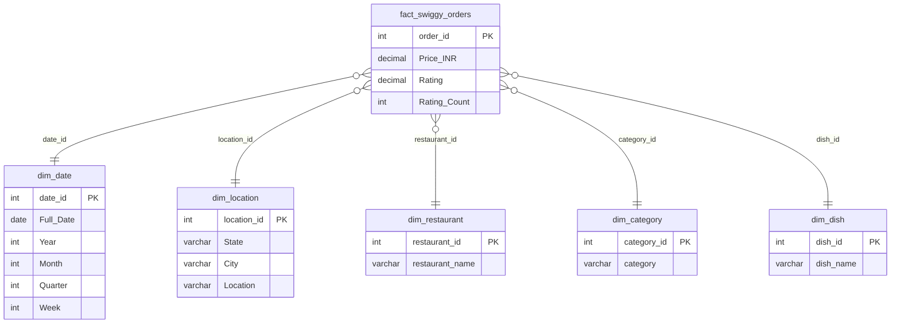

# Swiggy Sales Analysis (SQL Server)

End-to-end SQL project on Swiggy food-delivery data: data cleaning, star-schema modelling, KPI development and business analysis.

## Business Problem
The raw `swiggy_data` table holds food delivery records across states, cities, restaurants, categories and dishes. The goals are to:
1. Validate and clean the data (nulls, blanks, duplicates)
2. Model it into a star schema for fast, consistent reporting
3. Build KPIs and answer business questions on orders, revenue, locations, food performance, customer spend and ratings

Full requirements: [`docs/Business_Requirements.docx`](docs/Business_Requirements.docx)

## Dataset
| Item | Value |
|---|---|
| File | `data/Swiggy_Data.csv` |
| Raw rows | 197,430 |
| After removing duplicates | 197,403 (27 duplicates removed) |
| Date range | 01 Jan 2025 to 31 Aug 2025 |
| Columns | State, City, Order Date (dd-mm-yyyy), Restaurant Name, Location, Category, Dish Name, Price (INR), Rating, Rating Count |
| NULL / blank values | None found |

## Tools
SQL Server (T-SQL): CTEs, window functions (`ROW_NUMBER`, `SUM() OVER`), `CASE`, aggregations, joins, dimensional modelling.

## Star Schema


## Project Structure
```
├── README.md
├── data/Swiggy_Data.csv
├── docs/Business_Requirements.docx
└── sql/
    ├── 00_create_raw_table.sql     -- raw table + CSV load
    ├── 01_data_cleaning.sql        -- null, blank, duplicate checks and removal
    ├── 02_create_dim_tables.sql    -- 5 dimension tables
    ├── 03_create_fact_table.sql    -- fact table with foreign keys
    ├── 04_insert_data.sql          -- load dimensions + fact
    └── 05_kpi_and_analysis.sql     -- KPIs and deep-dive analysis
```
Run the scripts in numeric order.

## Key Results
| KPI | Value |
|---|---|
| Total Orders | 197,403 |
| Total Revenue | INR 53.00 Million |
| Average Dish Price | INR 268.50 |
| Average Rating | 4.34 |

**Date trends**
- Monthly orders stay steady at about 23k to 25k. January is highest (25,393) and February lowest (23,292, a shorter month).
- Saturday (28,933) and Sunday (28,470) are the busiest days; Tuesday (27,413) is the slowest.
- The data covers only Jan to Aug 2025, so Q3 is partial and year-over-year growth cannot be measured.

**Location**
- Bengaluru has about double the orders of any other city (20,072 vs about 10k for Mumbai, Hyderabad, Jaipur, Lucknow, New Delhi).
- Karnataka leads state revenue at about INR 5.46M, followed by Uttar Pradesh, Telangana, Maharashtra and Delhi.

**Food performance**
- Top restaurants by orders: McDonald's (13,528), KFC (12,957), Burger King (7,115), Pizza Hut (6,529), Domino's Pizza (5,489).
- Most ordered dish: Choco Lava Cake (303 orders).

**Customer spend (orders by price range)**
| Range | Orders |
|---|---|
| Under 100 | 26,796 |
| 100-199 | 56,369 |
| 200-299 | 54,773 |
| 300-499 | 43,768 |
| 500+ | 15,697 |

Most orders fall in the INR 100 to 299 range.

**Ratings:** 4-star ratings dominate (about 145k of 197k orders); 2-star or below is under 1%.

## Data Notes
- Each row is treated as one order, and revenue is the sum of dish price (not a full basket value).
- About 79k rows have `Rating_Count = 0` but still carry a rating; treat those ratings with care.
- The `Category` column mixes cuisines with menu sections (for example "Recommended" is the top category), so it is not a pure cuisine field.

## How to Run
1. Create a database in SQL Server and run `sql/00_create_raw_table.sql` (set the CSV path).
2. Run `01` to `05` in order.
3. Check that `fact_rows` equals `source_rows` (197,403) after script `04`.
